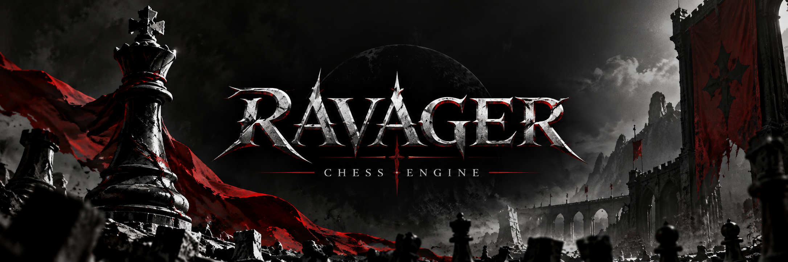

# Ravager 3



A UCI chess engine written in C11, pairing a modern alpha-beta search with an embedded NNUE and a tuned handcrafted evaluation fallback.

## Installation

Stable builds are published on the [releases page](https://github.com/erensh27/Ravager/releases).
Development builds of the current `main` branch (Linux and Windows, x86-64 with
AVX2, network embedded) are kept in [`dev-builds/`](dev-builds), rebuilt by
GitHub Actions on every change to the engine sources.

To build it yourself:

```bash
git clone https://github.com/erensh27/Ravager.git
cd Ravager
make            # native build for this machine: ./ravager
make release    # portable Linux build (x86-64-v3): ravager-linux-x64-avx2
make windows    # portable Windows build with MinGW-w64
```

The network is embedded into the binary at compile time (`EVALFILE`, default `nets/Ravager_NET.nnue`).

## Strength

| Version | [CCRL 40/15](https://computerchess.org.uk/ccrl/4040/rating_list_all.html) | [CCI VLTC](https://github.com/computer-chess-index/cci/blob/main/engines/Ravager.md) | [IPMAN](https://ipmanchess.yolasite.com/r9-7945hx-ai-engines.php) |
| ------- | ---------- | -------- | ----- |
| [Ravager 3](https://github.com/erensh27/Ravager/releases/tag/v3) | TBD | 3750 | 3562 |
| [Ravager Fury](https://github.com/erensh27/Ravager/releases/tag/v3.3.0) | 3585 | 3559 | - |
| Ravager 2 | 3329 | 3349 | - |

## Search

- Iterative deepening, principal variation search, aspiration windows that grow on failure and re-search fail-highs at reduced depth
- Lockless shared transposition table: three entries per 32-byte bucket, static evaluation stored alongside the score, PV flag, age-aware replacement, huge-page backing
- Staged move picker: TT move, SEE-filtered good captures, killer, quiet moves, losing captures
- Move ordering statistics: threat-aware butterfly and piece-to history, 1/2/4-ply continuation history, pawn-structure history, threat-aware capture history, plus bonuses for evading and creating threats
- Static evaluation scaled by material, damped by the fifty-move counter and corrected by pawn, non-pawn, minor-piece and continuation correction histories
- Whole-node pruning: razoring, reverse futility pruning, null-move pruning with verification, ProbCut with adaptive depth, internal iterative reductions, hindsight depth adjustment
- Move pruning: late move pruning, futility pruning, history pruning, SEE pruning with history-adjusted margins
- Singular, double and triple extensions, negative extensions and multi-cut
- Late move reductions driven by history, node type, TT-PV status, correction size and cutoff count, with deeper/shallower re-searches
- Quiescence search with stand-pat, SEE ordering, futility pruning and full check evasions
- Draw handling: repetitions, fifty-move rule, insufficient material and upcoming-repetition detection (cuckoo tables)
- Syzygy WDL probing in search and DTZ at the root
- Time management that scales with best-move stability, best-move node share, failed-low iterations and forced moves; full pondering support
- Lazy SMP with thread voting

## Evaluation

- CC0 network embedded in the binary
- 1,024-wide feature transformer per perspective
- 16 king buckets with horizontal mirroring for piece-square inputs
- Un-bucketed threat (attacker to victim) and same/adjacent-file pawn-pair inputs
- Separate piece-square and threat accumulators: a king move to a new bucket refreshes only the piece-square half, from a per-bucket accumulator cache
- Lazy, incremental accumulators built on demand from the nearest computed ancestor
- Pairwise CReLU products feeding a sparse `1024 -> 32` int8 layer, Hard-Swish, gated residual `32 -> 64 -> 32`, linear `32 -> 1`; eight material output buckets
- Neurons stored in a co-activation order so the sparse layer skips more all-zero input groups
- Scalar, AVX2, AVX-512 and AVX-512 VNNI kernels selected at runtime, all bit-identical
- Tuned handcrafted evaluation fallback when the network is disabled

## Board

- 64-bit bitboards with PEXT slider attacks
- Incremental Zobrist hashing, including pawn, non-pawn and minor-piece keys
- Legal-move filtering from incrementally maintained checkers and pins
- Orthodox chess and Chess960/FRC (X-FEN and Shredder-FEN castling rights)

## UCI Options

| Option | Default | Range / purpose |
| ------ | ------- | --------------- |
| Hash | 256 | 1-65536 MB transposition table |
| Threads | 1 | 1-1024 search threads |
| Clear Hash | | Empties the transposition table |
| Ponder | false | Allows pondering (`go ponder` / `ponderhit`) |
| UCI_Chess960 | false | Chess960 castling notation |
| MoveOverhead | 20 | 0-5000 ms reserved per move for communication lag |
| Use NNUE | true | false selects the handcrafted evaluation |
| EvalFile | `<empty>` | External network in the same format; empty restores the embedded one |
| SyzygyPath | `<empty>` | Tablebase directory |
| SyzygyProbeLimit | 6 | 0-7 pieces |
| Syzygy50MoveRule | true | Treat cursed wins / blessed losses as draws |

Supported `go` parameters: `wtime btime winc binc movestogo movetime depth nodes mate infinite ponder`.

## Commands

Besides UCI: `bench [depth]` (fixed-depth node count and speed), `perft <depth>`
and `d` (board, FEN, key and evaluation). From the shell: `./ravager bench`,
`./ravager perft 6`.

## License

See [LICENSE](LICENSE) and [docs/NOTICE.md](docs/NOTICE.md); third-party components are listed in [docs/CREDITS.md](docs/CREDITS.md).
